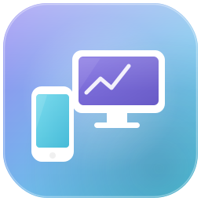

<h1 align="center">DX Manager</h1>

Samsung DeX and independent Android app windows on Windows.

Windows에서 Samsung DeX와 Android 앱별 단일창을 관리합니다.

<a href="#english">English</a> · <a href="#korean">한국어</a> ·
<a href="https://github.com/maze-mei/DX-Manager/releases/latest/download/DX-Manager-win-x64.zip">Windows x64 ZIP</a> ·
<a href="docs/RELEASE_NOTES_v3.0.0.md">v3.0.0 release notes</a> ·
<a href="docs/MACOS_GUIDE.md">macOS</a>

## English

DX Manager runs Samsung DeX and up to three independent app windows per
connected Galaxy phone. It manages ADB connections, launch profiles, capture
and file transfer around [scrcpy](https://github.com/Genymobile/scrcpy).

### Windows v3.0.0

| Component | Requirement |
| --- | --- |
| Windows | 64-bit Windows 7 SP1, 8.1, 10 or 11 |
| Runtime | .NET Framework 4.6.2 or later |
| Phone | A Galaxy phone with Samsung DeX support for DeX mode |
| Bundled scrcpy | 5.0.1 |
| Optional DX Companion | Shared official 3.0.0 (code 16), Android 13 or later |

- **Native DeX and simulated display.** Native DeX uses the phone's Samsung DeX
  desktop and is the default for new settings. It allows about 30 seconds to
  reconnect after a connection drops. Choose simulated display under Settings
  → Connection → Native DeX.
- **Experimental 120 FPS.** A Native DeX launch at 120 FPS uses simulated
  display after confirmation. Each 120 FPS launch shows a usage warning and
  keeps the phone screen on. The saved DeX mode is used again at 30 or 60 FPS.
- **Keyboard and mouse.** HID input, Korean/English key correction, and manual
  Enter / Shift+Enter switching with Scroll Lock. Manual switching is on for
  new settings. Optional automatic line breaks for ChatGPT, Claude, Gemini and
  Grok are off by default and use app switch detection in DX Companion.
- **Multiple phones.** Separate DeX sessions, app windows, profiles and transfer
  queues. Connect over USB or Wi-Fi ADB, including six-digit wireless pairing.
- **Capture and transfer.** Press F8 to capture, drop files or folders onto a
  scrcpy window to send them to the phone, or use the Companion app to send
  files and folders to the PC.
- **Settings and help.** English and Korean, light and dark themes, built-in
  guides, optional session log saving and environment checks.

<em>Native DeX settings with a sample device.</em>

### Download and start

1. Download the [Windows x64 ZIP](https://github.com/maze-mei/DX-Manager/releases/latest/download/DX-Manager-win-x64.zip)
   or open the [release page](https://github.com/maze-mei/DX-Manager/releases/latest).
2. Extract the whole **DX Manager v3.0.0** folder to a writable location and
   open **DXManager.exe**. Read and confirm the first-run notice.
3. Enable USB debugging on the phone, connect it, and accept its prompt.
4. Select the phone and start DeX. Choose a start app before starting Window 1–3.
5. To use Companion features, open **Settings → Companion** and install or
   update the bundled app. Enable Android accessibility in the Companion app
   only if you use AI app detection.

DX Manager checks GitHub in the background at most once per local day.
Use **Settings → About → Check for updates** to check manually. USB sessions
work offline, and Wi-Fi ADB uses the local network.

The latest Windows download uses a fixed URL. Each ZIP contains a folder
named for its version.

### Guides and source

[User guide](docs/USER_GUIDE_EN.md) · [FAQ](docs/FAQ_EN.md) ·
[Build from source](docs/BUILDING.md) · [DX Companion snapshot](companion/README.md) ·
[macOS guide](docs/MACOS_GUIDE.md)

The macOS implementation has its own build and guide. The v3.0.0 Windows ZIP
contains the portable WinForms application.

DX Manager is [MIT licensed](LICENSE). Native DeX activation adapts Java
code from [ScrcpyDeX v1.1](https://github.com/Aureliano021/ScrcpyDex/tree/eebbba903b73d54bbd13210096ea28fe31e51200)
by Aureliano Peixoto and contributors under Apache 2.0. The source and package
include the license and modification notice.
[Third-party notices](DexManager/licenses/THIRD_PARTY_NOTICES.md)

## 한국어

DX Manager는 연결한 Galaxy 휴대폰마다 Samsung DeX와 앱별 단일창을 최대 세 개까지
실행합니다. [scrcpy](https://github.com/Genymobile/scrcpy)를 이용해 ADB 연결,
실행 프로필, 캡처와 파일 전송을 관리합니다.

### Windows v3.0.0

| 구성 | 요구 사항 |
| --- | --- |
| Windows | 64비트 Windows 7 SP1, 8.1, 10 또는 11 |
| 런타임 | .NET Framework 4.6.2 이상 |
| 휴대폰 | DeX 모드는 Samsung DeX를 지원하는 Galaxy에서 사용 |
| 번들 scrcpy | 5.0.1 |
| 선택형 DX Companion | 공용 정식 3.0.0(code 16), Android 13 이상 |

- **네이티브 DeX와 보조 방식.** 새 설정에서는 삼성 DeX 데스크톱을 여는 네이티브 DeX를
  사용합니다. 연결이 끊기면 약 30초 동안 재연결을 기다립니다. 설정 → 연결 →
  네이티브 DeX에서 보조 디스플레이 시뮬레이션을 선택할 수 있습니다.
- **실험적 120 FPS.** 네이티브 DeX에서 120 FPS를 선택하고 동의하면 이번 실행에 보조
  방식을 사용합니다. 120 FPS로 시작할 때마다 사용 경고가 표시되고 휴대폰 화면을
  켜둡니다. 30 또는 60 FPS로 실행하면 저장한 DeX 방식을 따릅니다.
- **키보드와 마우스.** HID 입력과 한/영 키 보정, Scroll Lock을 이용한 수동
  Enter / Shift+Enter 전환을 지원합니다. 수동 전환은 새 설정에서 켜져 있습니다.
  ChatGPT, Claude, Gemini, Grok의 AI 앱 자동 줄바꿈은 기본 꺼짐이며, 사용하려면
  DX Companion 앱에서 앱 전환 감지를 켭니다.
- **여러 휴대폰.** DeX, 단일창, 앱 프로필과 전송 대기열을 기기별로 관리합니다.
  USB와 Wi-Fi ADB, 6자리 무선 디버깅 페어링을 지원합니다.
- **캡처와 파일 전송.** F8로 캡처하고, scrcpy 창에 파일이나 폴더를 놓아 휴대폰으로
  보냅니다. 휴대폰에서 PC로 보낼 때는 Companion 앱을 사용합니다.
- **설정과 도움말.** 한글·영문, 밝음·다크 테마, 내장 사용설명서와 FAQ,
  세션 로그 자동 저장과 환경 검사를 제공합니다.

<em>예시 기기를 선택한 네이티브 DeX 설정 화면.</em>

### 다운로드와 첫 실행

1. [최신 Windows x64 ZIP](https://github.com/maze-mei/DX-Manager/releases/latest/download/DX-Manager-win-x64.zip)이나
   [릴리스 페이지](https://github.com/maze-mei/DX-Manager/releases/latest)에서 받습니다.
2. **DX Manager v3.0.0** 폴더 전체를 쓰기 가능한 위치에 풀고 **DXManager.exe**를
   실행합니다. 첫 실행 안내를 읽고 확인합니다.
3. 휴대폰의 USB 디버깅을 켜고 연결한 뒤 허용 창을 승인합니다.
4. 대상 휴대폰을 선택하고 DeX를 시작합니다. 단일창 1~3을 시작할 때는 앱을 고릅니다.
5. 앱 연동이 필요하면 **설정 → Companion**에서 번들 앱을 설치하거나 업데이트합니다.
   AI 앱 감지를 사용할 때는 Companion 앱의 접근성을 켭니다.

업데이트는 하루에 한 번 백그라운드에서 확인합니다. **설정 → 정보 → 업데이트 확인**에서
직접 확인할 수도 있습니다. USB는 인터넷 없이 사용할 수 있고 Wi-Fi ADB는 로컬
네트워크를 사용합니다.

최신 Windows ZIP은 고정 주소에서 받을 수 있습니다. 압축 안의 폴더명으로 버전을 구분합니다.

### 문서와 소스

[전체 사용설명서](docs/USER_GUIDE_KO.md) · [FAQ](docs/FAQ_KO.md) ·
[소스 빌드](docs/BUILDING.md) · [DX Companion 소스와 APK](companion/README.md) ·
[macOS 가이드](docs/MACOS_GUIDE.md)

macOS 구현은 별도 빌드와 설명서를 사용합니다. v3.0.0 Windows ZIP은 포터블 WinForms 앱입니다.

DX Manager는 [MIT 라이선스](LICENSE)를 따릅니다. 네이티브 DeX 화면 생성에는
Aureliano Peixoto와 기여자의 [ScrcpyDeX v1.1](https://github.com/Aureliano021/ScrcpyDex/tree/eebbba903b73d54bbd13210096ea28fe31e51200)
Java 코드 일부를 Apache 2.0 조건에 따라 수정해 사용합니다.
[제3자 라이선스와 수정 고지](DexManager/licenses/THIRD_PARTY_NOTICES.md)
