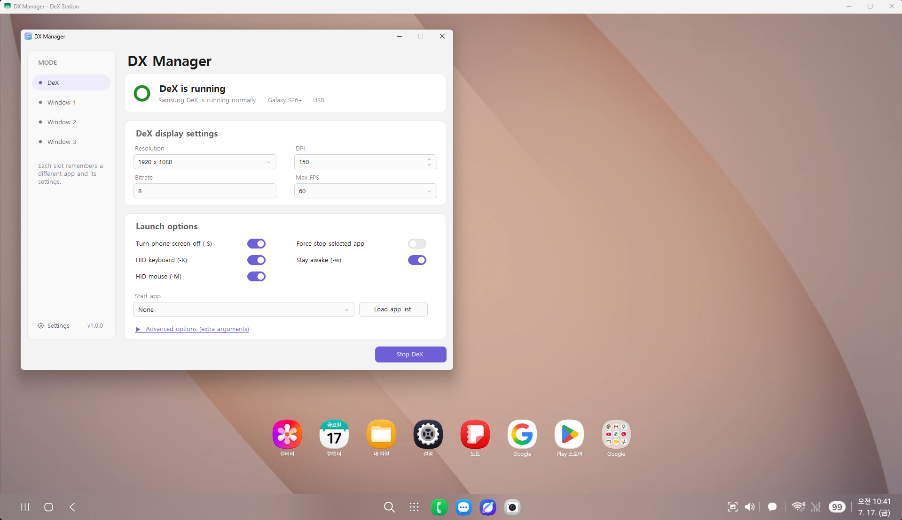
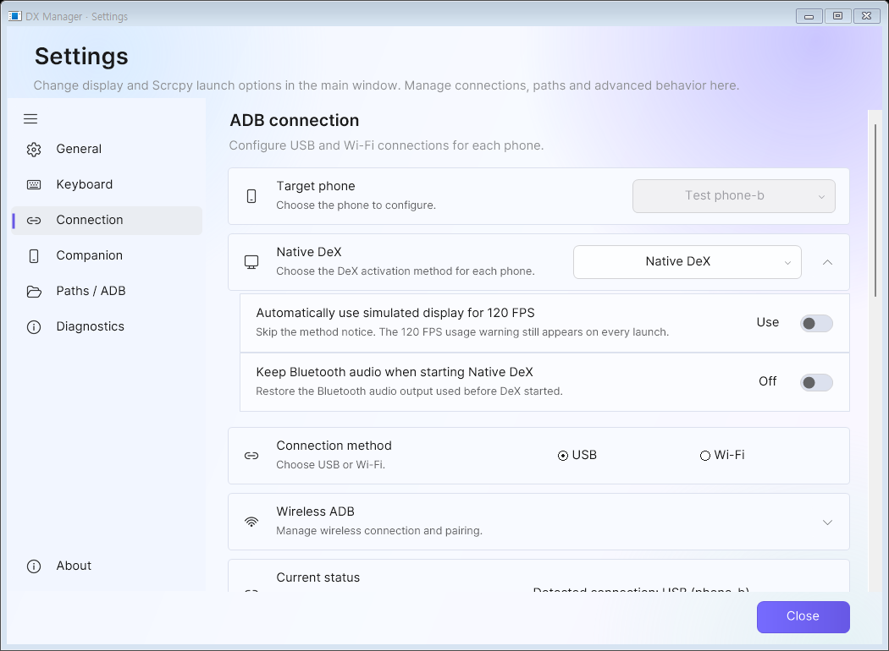
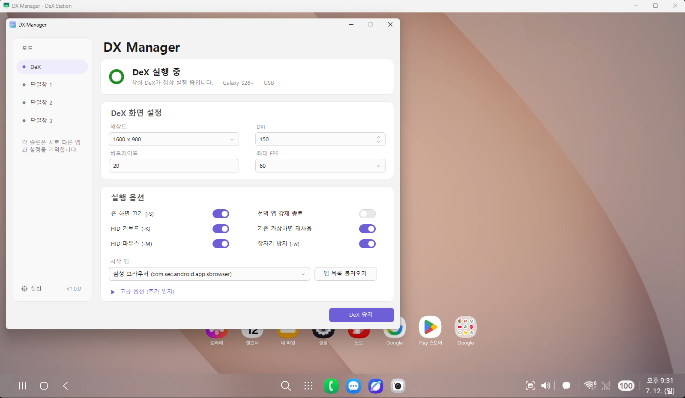
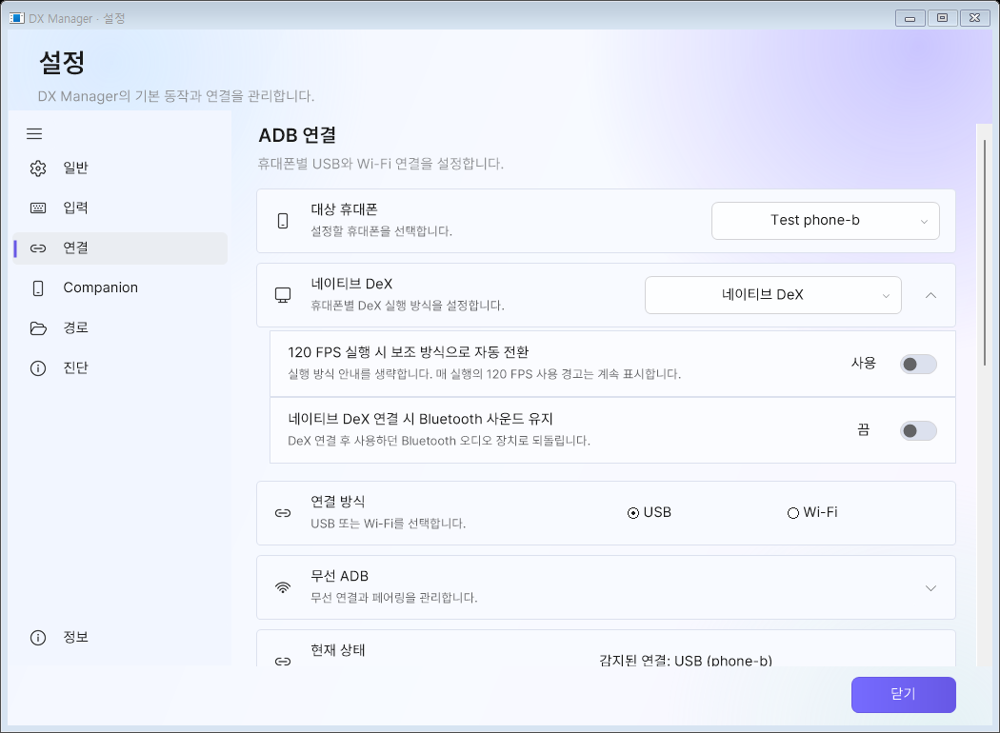

<h1 align="center">DX Manager</h1>

Samsung DeX and independent Android app windows on Windows.

Windows에서 Samsung DeX와 Android 앱별 단일창을 관리합니다.

<a href="#english">English</a> · <a href="#korean">한국어</a> ·
<a href="https://github.com/maze-mei/DX-Manager/releases/latest/download/DX-Manager-win-x64.zip">Windows x64 ZIP</a> ·
<a href="docs/USER_GUIDE_EN.md">User guide</a> · <a href="docs/USER_GUIDE_KO.md">사용설명서</a> ·
<a href="docs/RELEASE_NOTES_v3.0.0.md">v3.0.0 release notes</a> ·
<a href="docs/MACOS_GUIDE.md">macOS</a>

## English

### What is DX Manager?

DX Manager runs Samsung DeX and up to three independent app windows per
connected Galaxy phone. It manages ADB connections, launch profiles, capture
and file transfer around [scrcpy](https://github.com/Genymobile/scrcpy).

I started DX Manager as a personal set of batch and AutoHotkey scripts and
developed it into a C# desktop app for everyday DeX use, including on Windows 7
and PCs without internet access.

<small>DX Manager and a running Samsung DeX desktop on a Galaxy S26 Ultra, captured with v2.5.0.</small>

### Windows v3.0.0

| Component | Requirement |
| --- | --- |
| Windows | 64-bit Windows 7 SP1, 8.1, 10 or 11 |
| Runtime | .NET Framework 4.6.2 or later |
| Phone | A Galaxy phone with Samsung DeX support for DeX mode |
| Bundled scrcpy | 5.0.1 |
| Optional DX Companion | Shared official 3.0.0 (code 16), Android 13 or later |

Native DeX was tested on a Galaxy S26 Ultra running Android 17 and One UI 9.
Simulated display has also been used on Android 16 with One UI 8.x.
[Compatibility FAQ](docs/FAQ_EN.md#q18-the-dex-window-is-black-on-an-older-one-ui-version)

### Features

- **Native DeX and simulated display.** Native DeX uses the phone's Samsung DeX
  desktop and is the default for new settings. Reconnecting the same phone
  within about 30 seconds can reuse a surviving DeX display. The Bluetooth
  audio option restores the device used before Native DeX started. Choose the
  display mode under **Settings → Connection → Native DeX**.
- **Display settings.** Set resolution, DPI, bitrate and a frame-rate cap for
  DeX and each app slot. The default is 60 FPS. Native DeX runs at up to 60 FPS.
  For an experimental 120 FPS DeX session, DX Manager uses a simulated display
  after confirmation and keeps the phone screen on. Selecting 30 or 60 FPS
  restores the previous screen-off setting.
- **Keyboard and mouse.** HID input, Korean/English key correction, and manual
  Enter / Shift+Enter switching with Scroll Lock. Manual switching is on for
  new settings. Optional automatic line breaks for ChatGPT, Claude, Gemini and
  Grok are off by default and use app switch detection in DX Companion.
- **Multiple phones.** Separate DeX sessions, app windows, profiles and transfer
  queues. Choose USB, Wi-Fi ADB prepared over USB, or six-digit wireless
  debugging pairing. Each phone keeps its selected connection method.
- **Capture and transfer.** Capture a scrcpy window with F8 or its mini control
  bar. Drop files and folders onto the window to send them to the phone. DX
  Companion sends files and folders to the PC. Transfers preserve folder
  structure and Unicode names and number files when names collide.
- **Settings and help.** English and Korean, light and dark themes, built-in
  guides, optional session log saving and environment checks. Run the EXE
  again to restore the existing main window from the tray.

<em>Native DeX settings with a sample device.</em>

### Download, install and update

1. Download the [Windows x64 ZIP](https://github.com/maze-mei/DX-Manager/releases/latest/download/DX-Manager-win-x64.zip)
   or open the [release page](https://github.com/maze-mei/DX-Manager/releases/latest).
2. Extract the whole **DX Manager v3.0.0** folder to a writable location and
   open **DXManager.exe**. Read and confirm the first-run notice.
3. Enable **Developer options** and **USB debugging** on the phone. Connect it
   and approve the debugging prompt.
4. Select the phone and start DeX. Choose a start app before starting Window 1–3.
5. When finished, keep the phone connected until **Stop DeX** or tray **Exit**
   finishes cleanup.

To upgrade, exit the old copy and extract the new ZIP into its own folder.
Copy the old `config` folder to the new folder if you want to keep your settings.
USB sessions work offline. Wi-Fi ADB uses the local network.
Windows 7 or 8.1 may need additional legacy ADB prerequisites.
[Windows requirements](docs/USER_GUIDE_EN.md#1-requirements)

For websites and bookmarks, use the [fixed latest Windows download](https://github.com/maze-mei/DX-Manager/releases/latest/download/DX-Manager-win-x64.zip).
The folder inside the ZIP identifies the version.

### DX Companion

DX Companion is optional for basic DeX and single-window use. It adds
phone-to-PC transfers, cleanup controls, a Quick Settings tile and a home-screen
widget. Open **Settings → Companion** in DX Manager to install or update the
bundled app and grant cleanup permission. App switch detection and Android
accessibility support the optional AI line-break feature.
[DX Companion setup and transfers](docs/USER_GUIDE_EN.md#12-dx-companion-app-optional)

### Updates, shortcuts and help

DX Manager checks GitHub in the background once per local day. A new version
appears in a lower-right banner or a Windows tray notification. Use **Settings
→ About → Check for updates** to check manually. Download the new ZIP from the
release page. The app also shows local release notes after an upgrade.

| Action | Default shortcut |
| --- | --- |
| Start capture / capture the active scrcpy window | F8 / F8 again |
| Cancel capture | Esc |
| Exit DX Manager | Left Alt+F8 |
| Switch between Enter and Shift+Enter | Scroll Lock, when manual switching is enabled |
| Toggle fullscreen / fit the window to 1:1 video size | Alt+F or F11 / Alt+G |
| Turn FPS logging on or off | Alt+I |
| Turn the phone screen off / on | Alt+O / Alt+Shift+O |

For bug reports, include your DX Manager version and a diagnostic report with
personal information removed. [Report an issue](https://github.com/maze-mei/DX-Manager/issues)

[User guide](docs/USER_GUIDE_EN.md) · [FAQ](docs/FAQ_EN.md) · [v3.0.0 changes and ZIP checksum](docs/RELEASE_NOTES_v3.0.0.md)

### macOS, source and licenses

The repository also contains a .NET 8 macOS TUI/CLI for macOS 14 or later on
Apple Silicon and Intel. [macOS guide](docs/MACOS_GUIDE.md)

The Windows source includes the matching Companion source and signed APK.
[Windows build guide](docs/BUILDING.md) · [DX Companion source and APK](companion/README.md)

DX Manager is [MIT licensed](LICENSE). Native DeX activation adapts Java
code from [ScrcpyDeX v1.1](https://github.com/Aureliano021/ScrcpyDex/tree/eebbba903b73d54bbd13210096ea28fe31e51200)
by Aureliano Peixoto and contributors under Apache 2.0. The source and package
include the license and modification notice.
[Third-party notices](DexManager/licenses/THIRD_PARTY_NOTICES.md)

---

## 한국어

### DX Manager는 어떤 프로그램인가요?

DX Manager는 연결한 Galaxy 휴대폰마다 Samsung DeX와 앱별 단일창을 최대 세 개까지
실행합니다. [scrcpy](https://github.com/Genymobile/scrcpy)를 이용해 ADB 연결,
실행 프로필, 캡처와 파일 전송을 관리합니다.

개인용 배치 파일과 AutoHotkey 스크립트에서 시작해 C# 데스크톱 앱으로 만들었습니다.
Windows 7이나 인터넷이 없는 PC에서도 일상적으로 DeX를 쓸 수 있도록 개발하고 있습니다.

<small>Galaxy S26 Ultra에서 DX Manager와 Samsung DeX를 실행한 v2.5.0 화면입니다.</small>

### Windows v3.0.0

| 구성 | 요구 사항 |
| --- | --- |
| Windows | 64비트 Windows 7 SP1, 8.1, 10 또는 11 |
| 런타임 | .NET Framework 4.6.2 이상 |
| 휴대폰 | DeX 모드는 Samsung DeX를 지원하는 Galaxy에서 사용 |
| 번들 scrcpy | 5.0.1 |
| 선택형 DX Companion | 공용 정식 3.0.0(code 16), Android 13 이상 |

네이티브 DeX는 Galaxy S26 Ultra의 Android 17과 One UI 9에서 확인했습니다.
보조 디스플레이 방식은 Android 16과 One UI 8.x에서도 사용했습니다.
[호환성 FAQ](docs/FAQ_KO.md#q18-이전-one-ui-버전에서-dex-창이-검게-표시됩니다)

### 주요 기능

- **네이티브 DeX와 보조 방식.** 새 설정에서는 삼성 DeX 데스크톱을 여는 네이티브 DeX를
  사용합니다. 같은 휴대폰이 약 30초 안에 다시 연결되고 DeX 화면이 남아 있으면
  이어서 사용할 수 있습니다. 시작하기 전에 쓰던 Bluetooth 오디오 장치로 소리를
  돌리는 옵션도 있습니다. **설정 → 연결 → 네이티브 DeX**에서 실행 방식을 고릅니다.
- **화면 설정.** 해상도·DPI·비트레이트와 최대 FPS를 DeX와 단일창별로 설정합니다.
  기본값은 60 FPS이며 네이티브 DeX는 최대 60 FPS로 동작합니다. DeX에서 실험적
  120 FPS를 선택하고 동의하면 보조 디스플레이를 사용하며 휴대폰 화면을 켜둡니다.
  30·60 FPS로 돌아가면 이전 화면 끄기 설정을 복원합니다.
- **키보드와 마우스.** HID 입력과 한/영 키 보정, Scroll Lock을 이용한 수동
  Enter / Shift+Enter 전환을 지원합니다. 수동 전환은 새 설정에서 켜져 있습니다.
  ChatGPT, Claude, Gemini, Grok의 AI 앱 자동 줄바꿈은 기본 꺼짐이며, 사용하려면
  DX Companion 앱에서 앱 전환 감지를 켭니다.
- **여러 휴대폰.** DeX, 단일창, 앱 프로필과 전송 대기열을 기기별로 관리합니다.
  USB, USB로 준비하는 Wi-Fi ADB, 6자리 무선 디버깅 페어링을 지원합니다.
  각 휴대폰은 선택한 연결 방식을 따릅니다.
- **캡처와 파일 전송.** F8이나 scrcpy 창의 미니 컨트롤바로 캡처합니다. scrcpy 창에
  파일·폴더를 놓으면 휴대폰으로 보내고, PC로 보낼 때는 Companion 앱을 사용합니다.
  폴더 구조와 한글 파일명을 보존하고, 이름이 겹치면 번호를 붙입니다.
- **설정과 도움말.** 한글·영문, 밝음·다크 테마, 내장 사용설명서와 FAQ,
  세션 로그 자동 저장과 환경 검사를 제공합니다. EXE를 다시 실행하면 트레이에
  있는 메인 창이 열립니다.

<em>예시 기기를 선택한 네이티브 DeX 설정 화면.</em>

### 다운로드·설치·업데이트

1. [최신 Windows x64 ZIP](https://github.com/maze-mei/DX-Manager/releases/latest/download/DX-Manager-win-x64.zip)이나
   [릴리스 페이지](https://github.com/maze-mei/DX-Manager/releases/latest)에서 받습니다.
2. **DX Manager v3.0.0** 폴더 전체를 쓰기 가능한 위치에 풀고 **DXManager.exe**를
   실행합니다. 첫 실행 안내를 읽고 확인합니다.
3. 휴대폰에서 **개발자 옵션 → USB 디버깅**을 켜고 연결한 뒤 허용 창을 승인합니다.
4. 대상 휴대폰을 선택하고 DeX를 시작합니다. 단일창 1~3을 시작할 때는 앱을 고릅니다.
5. 사용을 마칠 때는 **DeX 중지**나 트레이 **종료**의 정리가 끝날 때까지 휴대폰을 연결해 둡니다.

업데이트할 때는 기존 프로그램을 종료하고 새 ZIP을 별도 폴더에 풉니다. 설정을 옮기려면
기존 `config` 폴더를 새 폴더에 복사하세요. USB 연결은 인터넷 없이 사용할 수 있고,
Wi-Fi ADB는 로컬 네트워크를 사용합니다.
Windows 7·8.1에서는 레거시 ADB 실행에 필요한 업데이트가 있을 수 있습니다.
[Windows 준비 사항](docs/USER_GUIDE_KO.md#1-준비-사항)

외부 사이트나 즐겨찾기에 링크할 때는 [최신 Windows ZIP 고정 주소](https://github.com/maze-mei/DX-Manager/releases/latest/download/DX-Manager-win-x64.zip)를 사용하세요.
압축 안의 폴더명으로 버전을 구분합니다.

### DX Companion

DX Companion 앱은 선택 사항입니다. 휴대폰에서 PC로 파일을 보내거나, 화면을 정리하거나,
빠른 설정 타일과 홈 화면 위젯을 쓸 때 설치하면 됩니다. DX Manager의 **설정 → Companion**에서
번들 앱을 설치·업데이트하고 정리 권한을 부여할 수 있습니다. AI 앱 자동 줄바꿈을 쓰려면
Companion 앱에서 앱 전환 감지를 켜고 Android 접근성을 허용하세요.
[DX Companion 설치와 전송](docs/USER_GUIDE_KO.md#12-선택형-dx-companion-앱)

### 업데이트 확인·단축키·도움말

DX Manager는 하루 한 번 백그라운드에서 GitHub 업데이트를 확인합니다. 새 버전이 있으면
메인 창 오른쪽 아래 배너나 Windows 트레이 알림이 표시됩니다. **설정 → 정보 → 업데이트 확인**에서
직접 확인할 수 있고, 새 ZIP은 릴리스 페이지에서 받습니다. 업데이트 후에는 앱에서 변경사항을 볼 수 있습니다.

| 동작 | 기본 단축키 |
| --- | --- |
| 캡처 시작 / 활성 scrcpy 창 캡처 | F8 / F8 다시 누르기 |
| 캡처 취소 | Esc |
| DX Manager 종료 | 왼쪽 Alt+F8 |
| Enter와 Shift+Enter 전환 | 수동 전환을 켠 상태에서 Scroll Lock |
| 전체 화면 / 영상의 1:1 크기로 조정 | Alt+F 또는 F11 / Alt+G |
| FPS 로그 켜기·끄기 | Alt+I |
| 휴대폰 화면 끄기 / 켜기 | Alt+O / Alt+Shift+O |

문제를 제보할 때는 DX Manager 버전과 개인정보를 가린 진단 보고서를 함께 남겨주세요.
[GitHub 이슈](https://github.com/maze-mei/DX-Manager/issues)

[전체 사용설명서](docs/USER_GUIDE_KO.md) · [FAQ](docs/FAQ_KO.md) · [v3.0.0 변경사항과 ZIP 해시](docs/RELEASE_NOTES_v3.0.0.md)

### macOS·소스·라이선스

macOS 14 이상에서 Apple Silicon과 Intel을 지원하는 .NET 8 TUI/CLI 소스도 있습니다.
[macOS 가이드](docs/MACOS_GUIDE.md)

Windows 소스에는 해당 버전의 Companion 앱 소스와 서명된 APK가 들어 있습니다.
[Windows 소스 빌드](docs/BUILDING.md) · [DX Companion 소스와 APK](companion/README.md)

DX Manager는 [MIT 라이선스](LICENSE)를 따릅니다. 네이티브 DeX 화면 생성에는
Aureliano Peixoto와 기여자의 [ScrcpyDeX v1.1](https://github.com/Aureliano021/ScrcpyDex/tree/eebbba903b73d54bbd13210096ea28fe31e51200)
Java 코드 일부를 Apache 2.0 조건에 따라 수정해 사용합니다.
[제3자 라이선스와 수정 고지](DexManager/licenses/THIRD_PARTY_NOTICES.md)
