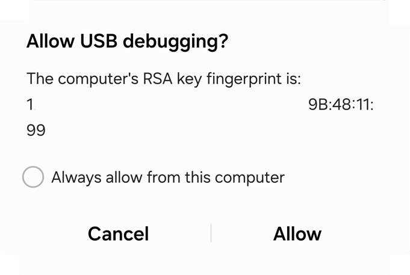
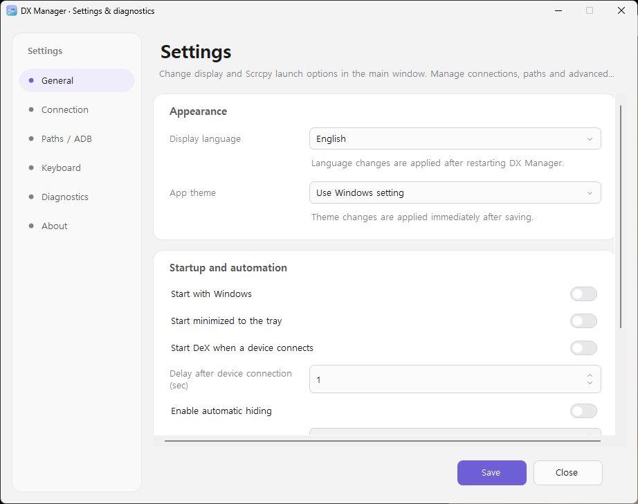

# DX Manager User Guide

> Windows v3.0.1
> Uses shared DX Companion 3.0.0 (code 16) and scrcpy 5.0.1. Some pictures show an earlier interface.

## 1. Requirements

### PC

- 64-bit Windows 7 SP1, 8.1, 10, or 11 (32-bit Windows is not supported)
- .NET Framework 4.6.2 or later
- Windows 7/8.1: Universal CRT updates required by the bundled legacy ADB
- Enough disk space to extract the complete release archive
- A user-writable extraction folder; DX Manager stores config, logs, and
  screenshots beside the executable

DX Manager intentionally targets .NET Framework 4.6.2 as its minimum runtime
to support Windows 7 SP1 and offline or closed-network PCs. Windows 7 SP1 does
not include 4.6.2 by default. If it is missing, download the runtime from the
[official Microsoft .NET Framework 4.6.2 page](https://dotnet.microsoft.com/en-us/download/dotnet-framework/net462).
For an offline PC, download the offline installer on another computer and
transfer it before setup. If .NET Framework 4.7.2 or 4.8 is already installed,
do not downgrade it or install 4.6.2 separately; later .NET Framework 4.x
versions satisfy this requirement.

### Phone

- A Samsung Galaxy device that supports Samsung DeX
- Developer options enabled
- USB debugging enabled
- A data-capable USB cable

The existing simulated-display path has been used on Android 16/One UI 8.x. Current Native DeX field testing uses a Galaxy S26 Ultra with Android 17/One UI 9.0. This is not a guarantee for all Galaxy devices or firmware; compare the other DeX mode or a single window when compatibility differs.

Approve the RSA debugging prompt shown on the phone during the first
connection. You may select **Always allow from this computer** on a trusted
PC.

  

## 2. Installation and First Run

1. Extract the complete release ZIP to a folder your account can write to.
   Avoid protected locations such as `Program Files` unless write permission
   has been configured.
2. Run `DXManager.exe`.
3. If Windows displays a security warning, verify the file source before
   allowing it to run.
4. Connect the phone over USB and approve the RSA debugging prompt.
5. Wait for the device-connected status.
6. Select **Start DeX**.

After detecting an authorized USB or wireless device, DX Manager waits for
the configured device-start delay before sending session start commands. The
default delay is one second and helps newly connected devices settle before
scrcpy starts.

Do not copy `DXManager.exe` by itself. Keep the complete distribution,
including the `tools` directory, scrcpy DLLs, `scrcpy-server`, and license
files. This portable bundle includes scrcpy 5.0.1.

> [!IMPORTANT]
> Keep the phone connected and use **Stop DeX**, press `Left Alt+F8`, or
> right-click the DX Manager tray icon and select **Exit**. Wait for cleanup
> to finish before disconnecting USB or wireless ADB.
> If USB/Wi-Fi is disconnected first, Android may leave the simulated display
> visible on the phone.

To remove a display that remains on the phone, open **Developer options >
Simulate secondary displays**, select any resolution once, open the same menu
again, and then select **None**. Selecting **None** first may not clear a stale
display. See [FAQ Q1](FAQ_EN.md#q1-a-small-screen-secondary-display-remains-on-the-phone)
for screenshots.

### Using multiple phones

DX Manager 2.0 can manage multiple physical Galaxy phones simultaneously.
When only one phone is known during the current run, the device selector is
hidden. It appears after a second phone is detected and remains available for
that run so disconnected sessions can still be identified.

Select a phone in the left device list before changing settings or starting a
session. Each phone keeps its own DeX and three Single-Window settings, app
profiles, selected USB/Wi-Fi policy, DX Companion app session, and bidirectional
file-transfer state. A USB and wireless ADB connection belonging to the same
physical phone are merged into one device entry. DX Manager uses only the
connection method selected for that phone and does not silently switch to the
other transport.

Scrcpy window titles include the phone display name. Files received from DX
Companion app are stored under a phone-name subfolder inside the configured PC
destination.

## 3. DeX Mode

### Choose Native or simulated display

Choose **Native DeX** or **Simulated secondary display** under **Settings → Connection → Native DeX**. Native is the fresh default. An explicitly saved mode is preserved. Stop and start DeX after changing it.

When starting Native DeX, DX Manager removes any simulated secondary displays configured on that phone and waits for their removal. Virtual displays created by scrcpy remain available.

Native uses the phone's Samsung DeX environment. Simulated display keeps the existing path: it can show a small secondary-screen preview on the phone, starts quickly and offers experimental 120 FPS. Device/app behavior and desktop UI can differ between these paths.

### 120 FPS and phone screen-on

Native DeX runs at up to 60 FPS. If you select 120 FPS for DeX and accept the switch, DX Manager uses **simulated display for that launch**. Starting at 30 or 60 FPS uses your saved DeX mode.

To skip the mode-switch notice, expand **Settings → Connection → Native DeX** and enable **Automatically use simulated display for 120 FPS**. This is the same setting as the remember checkbox in the notice. The 120 FPS usage warning still appears on each launch.

Selecting 120 FPS turns off and disables **Turn phone screen off**. Returning to 30 or 60 FPS restores your previous choice. Actual FPS depends on the phone, app and input activity.

Single windows on the same phone are limited to 60 FPS while the Native DeX display is running or waiting to reconnect. Their 120 FPS setting is kept. Once Native DeX closes, they can use their configured maximum.

To see the actual frame rate, select **Settings → Diagnostics → Open log window**. Focus the scrcpy window and press left `Alt+I` to show FPS in the log. Press it again to turn the counter off.

### Thirty-second reconnection grace

Native DeX waits about 30 seconds after USB/Wi-Fi disconnection is detected, then removes its owned display. Reconnecting the same phone within that grace cancels cleanup and reuses a surviving display. If the OS already removed it, a new display is created. Opening the PC viewer still follows your automatic-start preference.

The Companion app cleanup timer applies to simulated displays. When a Native DeX connection drops, sound returns to the phone and Stay awake is released. Reopening the DeX window reapplies the session's audio and power settings. An active Bluetooth audio route is kept.

To restore the Bluetooth device you used before DeX started, expand **Settings → Connection → Native DeX** and enable **Keep Bluetooth audio when starting Native DeX**.

Explicit Stop, application exit and Windows shutdown clean up immediately. Phone/system lifetime policies can remove a display before the grace ends, so survival for the full interval is not guaranteed. Simulated display keeps its existing Companion app cleanup preference.

Select **DeX** in the left navigation. DeX can open its desktop with **None** selected as the start app. If you select an app, it opens when DeX starts.

### Display Settings

- **Resolution**: select a preset or enter a custom size
- **DPI**: controls Android display scaling
- **Bitrate**: controls video quality and network usage
- **Maximum FPS**: select 30, 60 or experimental 120 FPS

A lower DPI value makes Android UI elements smaller, allowing more information
to fit on the screen.

Custom resolution values are stored separately from the presets. Selecting a
preset does not overwrite the last custom width and height.

scrcpy automatically scales the video to fit the PC monitor and current window
size. The visible scrcpy window size therefore does not change the actual DeX
resolution configured in DX Manager. Custom width and height values may each
be set up to 4096.

### Run Options

- **Turn phone screen off (`-S`)**: turns off the physical screen while
  scrcpy is running
- **HID keyboard (`-K`)**: sends the keyboard as an Android input device
- **HID mouse (`-M`)**: sends the mouse as an Android input device
- **Force-stop selected app**: stops the existing app process before launch
- **Stay awake (`-w`)**: keeps the phone awake during the session

In Wi-Fi Native DeX, Stay awake also works on battery power with the phone screen off.

Turn phone screen off (`-S`) does not lock the phone. It only turns off the
physical panel while the device remains active. Touch, long-press, and
fingerprint input may still work with the screen off, so take care to avoid
unintended settings changes or app actions.

When HID keyboard and HID mouse are disabled, scrcpy uses its non-HID input
mode. Mouse input is sent like direct touchscreen input, and holding a mouse
button acts like a long press.

Non-HID keyboard behavior differs slightly from HID mode. English input is
available, but the Korean/English key may not work. Use left Shift+Space to
switch the input language. This shortcut may also depend on the Android
keyboard and system configuration.

When settings have changed, selecting the run button cleans up the existing
DeX session when necessary and restarts it with the new values.

To stop scrcpy from forwarding sound to the PC, add `--no-audio` under **Advanced options** and restart the session.

## 4. Single-Window Mode

Select **Window 1**, **Window 2**, or **Window 3** in the left navigation.
Each slot stores its own resolution, DPI, bitrate, FPS, app, and run options.

1. Select **Load app list**.
2. Choose the app to launch.
3. Configure the display and run options.
4. Select **Start window**.

A single window needs an app to start. If the list shows **None**, select the app you want to launch.

Each phone has its own app list. Switching phones restores that phone's last
loaded list during the current DX Manager run. A brief message shows how many
apps were loaded. A result arriving after a phone switch is kept for its source
phone.

Apps that were launched successfully are kept in that phone's recent-app list.
They can be selected in another slot on the same phone or after restarting DX
Manager. Older shared recent entries are preserved in settings but are not
automatically assigned to a phone; its saved start-app selection is retained.

### App profiles

Single-window mode can save one profile for each selected Android package.
Configure the display and run options, then select **Save profile**. The profile stores resolution, DPI, bitrate, FPS,
screen-off, Stay awake, HID input, force-stop, flex-display, and additional
arguments. Selecting the same app in any of the three slots automatically
applies the saved profile to that slot.

To replace a profile, change the options and select **Save profile** again. Deleting a profile does
not change the settings already loaded into the current slot, and DeX mode is
never affected by single-window profiles.

Single-window mode does not reuse the DeX overlay display. Each slot uses
scrcpy's new virtual display feature, so DeX and three app windows can run at
the same time.

- **Flex display (`-x`)**: adjusts the virtual display when the window changes
  size
- Single-window title: `DX Manager - App name`
- DeX window title: `DX Manager - DeX Station`

For some games, disabling HID keyboard and HID mouse and using single-window
mode may provide better input compatibility.

## 5. Drag-and-Drop File Transfer

Drop one or more files, or a complete folder, onto a running DeX or single-app
scrcpy window. DX Manager file transfer is enabled by default and uses a
Windows 7 SP1 through 11-compatible path to preserve Korean, Japanese, and other Unicode
names. The default phone destination is `/sdcard/Download/`; change it under
**Settings → Paths / ADB → File transfer paths**. Expand **PC → phone file transfer**
and change **Phone destination folder**. Use **Choose on phone** to select a folder on
the connected phone. The destination must be under `/sdcard/` or `/storage/emulated/0/`.
Changes apply to newly opened DeX and single-app windows.

When a folder is dropped, its top-level folder, subfolders, files, and empty
folders are preserved. Junctions, symbolic links, and other reparse points are
skipped to prevent following a folder outside the selected tree. A standalone
APK drop keeps scrcpy's install behavior, while an APK contained in a dropped
folder is copied as a regular file.

The independent, movable status window initially opens beside the scrcpy
window. It shows the active item and up to four waiting items, file size,
elapsed time, and completed/failed/waiting counts. It intentionally does not
show a percentage or ETA because reliable byte progress is not available on
every supported Windows/ADB combination. Select **Cancel** to stop all active
and waiting transfers for that scrcpy window and attempt to remove their
temporary phone data. Cancel is disabled during the brief final commit step so
an already completed move cannot be reported inconsistently.

Existing phone files and folders are not overwritten. DX Manager uses
`name (1).ext`, `name (2).ext`, or `folder (1)` when a name already exists.

## 6. USB Connection

USB is the default connection mode.

1. Enable USB debugging on the phone. If the option is unavailable or shown
   in gray, check **Settings > Security and privacy > Auto Blocker** on the
   Galaxy device. After disabling Auto Blocker, USB debugging can be enabled.
   If its automatic re-enable option is active, Auto Blocker may turn on again
   after about 30 minutes and disconnect USB debugging. Menu names and
   locations may vary by One UI version.
2. Connect the phone to the PC with a USB cable.
3. Approve the RSA debugging prompt.
4. Confirm the connected status in DX Manager.

If the device does not appear, check the cable, USB port, Samsung USB driver,
and RSA authorization. Then run
**Settings > Diagnostics > Run environment check**.

## 7. Wireless Connection

### Prepare Wireless ADB over USB

This is the simplest method for the first connection or after a phone reboot.

1. Connect the PC and phone to the same local network.
2. Connect the authorized phone over USB.
3. Open **Settings > Connection** and select **Use wireless ADB**.
4. Leave the phone IP address empty to let DX Manager detect the Wi-Fi
   address.
5. Confirm the connection port. The default is `5555`.
6. Select **Prepare over USB**.
7. After the wireless connection succeeds, disconnect the USB cable.

If automatic address detection fails, find the phone's IPv4 address in its
Wi-Fi details and enter it manually.

### Android 11+ Pairing

1. Enable **Developer options > Wireless debugging** on the phone.
2. Open **Pair device with pairing code**.
3. Enter the phone IP address, pairing port, and six-digit code in DX Manager.
4. Select **Pair**. DX Manager discovers the separate connect endpoint and
   connects automatically when it can identify exactly one matching phone.
5. If endpoint discovery is unavailable or ambiguous, enter the **connection
   port** shown on the main Wireless debugging screen and select
   **Connect wirelessly** as a fallback.

The pairing port and connection port are different; the connection port may
change after Wireless debugging restarts. DX Manager updates the saved endpoint
only after it verifies that the connection belongs to the paired phone. The
pairing code is not stored in settings or written to the log.

### Wireless Troubleshooting

- Devices using the same Wi-Fi name may still be unable to communicate.
- Check guest Wi-Fi, AP/client isolation, VLAN rules, and corporate firewalls.
- If automatic endpoint discovery is blocked, use the current connection port
  from the phone's Wireless debugging screen, not the pairing port.
- USB preparation may be required again after the phone restarts.
- If the first connection fails on 5GHz, check the router configuration or
  initialize the connection on 2.4GHz before retrying.

## 8. Capture

The capture hotkey only works while a scrcpy window is active.

1. Press `F8` to bring the scrcpy window forward and show the capture hint.
2. Press `F8` again to capture only the scrcpy client area.
3. Drag the mouse to capture a selected region.
4. Press `Esc` to cancel.

Drag capture is not limited to the scrcpy window. You can select an area from
a webpage, document, or another PC application and send the captured image
directly to the phone.

Captures go to the `screenshot` folder inside the application folder by default.
Change the destination under **Settings → Paths / ADB → PC screenshot folder**.
If **Send captures to phone** is enabled, the capture also goes to the phone folder selected on that page.

The screenshot button on the DeX taskbar does not work on the virtual DeX
display created by DX Manager. Use DX Manager's `F8` capture feature instead.

## 9. Keyboard Correction

### Automatic Enter rules for AI apps

Turn on **Settings → Keyboard → AI app automatic line breaks** to expand the app list.
Use the individual switches for ChatGPT, Claude, Gemini and Grok. Enter sends
Shift+Enter in enabled apps and ordinary Enter elsewhere. The Gemini switch covers
the Gemini app and the installed Gemini web app. The feature is off by default.

Install DX Companion 3.0.0 and follow **Companion app → Settings → App switch detection card → Open Accessibility settings → Installed apps → DX Companion app → On**. Accessibility is optional for detection and is not required for transfer or basic DeX. Enter remains default when app information is unavailable.

Turning on AI line breaks turns off manual **Switch Enter / Shift+Enter**.
To use Scroll Lock, turn on **Switch Enter / Shift+Enter** and press Scroll Lock
in the scrcpy window. It starts in ordinary Enter mode and switches on each press.
Manual switching is on for new settings and works without the Companion app.

Keyboard correction is only applied while a scrcpy window is active.

- **Korean/English key correction** sends the key as Android Shift+Space.
- **Right Windows key correction** improves Android input compatibility.
- Direct Shift+Space input can optionally be ignored (off by default).

On Windows, the physical right Shift forwarding problem was reproduced with
scrcpy 4.0/SDL3 even though Windows detected the key. For compatibility with
SDL3-based scrcpy 4.x clients, DX Manager maps right Shift to left Shift only
while such a scrcpy window is active. Normal Shift typing is preserved, but
Android cannot distinguish the left and right Shift keys in that session.

The default capture shortcut is `F8`, and the default exit shortcut is
`Left Alt+F8`. To change one, select its field under **Settings → Keyboard**
and press the desired key. Combine Ctrl, Alt or Shift with a regular key such as F8.

### Useful scrcpy shortcuts

These are scrcpy-window shortcuts, not Samsung DeX shortcuts. The examples
below use left `Alt`, one of scrcpy's default shortcut modifiers.

| Shortcut | Action |
| --- | --- |
| `Alt+F` or `F11` | Toggle fullscreen |
| `Alt+G` | Resize the window to the video's 1:1 pixel size |
| `Alt+I` | Toggle the FPS counter in the session log |
| `Alt+P` | Press the phone's power button |
| `Alt+O` | Turn the phone screen off (`O` is the letter O) |
| `Alt+Shift+O` | Turn the phone screen on |
| `Alt+V` | Synchronize the PC clipboard and paste |
| `Ctrl+V` | Send Ctrl+V to the active Android app (app-dependent) |

Other [official scrcpy 5.0.1 shortcuts](https://github.com/Genymobile/scrcpy/blob/v5.0.1/doc/shortcuts.md)
may work, but some Android system shortcuts can do nothing or act on the
phone's primary display instead of the simulated DeX display.

### Mini control bar

When **Settings > General > Show a mini control bar beside scrcpy windows** is
enabled, each DeX and single-app window has its own narrow control bar. It
follows the associated scrcpy window and provides phone screen off/on, power,
fullscreen, 1:1 window size, capture, and **Open DX Manager** actions. Hover
over a button to see its description and matching shortcut.

The control bar may be placed on the left or right under **Settings >
General**, and its bottom button collapses or expands it. It follows the
associated window's activation, minimization, and stacking order, so a bar
from a background session should not cover the active session.

## 10. Automatic Hiding and System Tray

When automatic hiding is enabled, DX Manager hides the running scrcpy windows
and its own UI after the configured idle period, then remains in the system
tray.

Keyboard or mouse activity does not automatically restore the windows. Click
the scrcpy window on the Windows taskbar, double-click the tray icon, or select
the open command from the tray menu to restore them.

The window close button hides DX Manager to the tray. To terminate it
completely, press `Left Alt+F8`, or right-click the tray icon and select
**Exit**. Keep the phone connected until session cleanup is complete.

## 11. Logs and Diagnostics

### Session Log

Log View shows the current session and supports manual saving. **Settings → Diagnostics → Open session log → Automatically save session logs** writes session and diagnostic files under the app `logs` folder. Off for fresh settings; an existing saved preference is preserved. Disabling it keeps in-memory history and existing files.

In Log View, important progress entries use purple for the entire timestamp/level/message, warnings/errors use orange/red, and routine tool/scrcpy output keeps the normal color. Saved files do not gain color tags.

The log may include:

- Selected ADB path and version
- Device connection state
- DeX and single-window launch results
- Display ID detection results
- scrcpy output and errors

ADB prints the common protocol banner `Android Debug Bridge version 1.0.41`
for multiple platform-tools releases. DX Manager displays the actual build
from the following `Version ...` line, such as `37.0.1-15733141` for the
bundled scrcpy ADB or `34.0.1-9979309` for the bundled legacy ADB.

### Update checks

DX Manager checks GitHub for updates in the background once per local day.
Select **Settings → About → Check for updates** to check manually.
When a newer version is available, open its GitHub release page to download it.

### Environment Check

Use **Settings > Diagnostics > Run environment check** to verify ADB, scrcpy,
Windows, device connectivity, and important folders.

The **Selected device version** card shows the currently selected phone's
model, transport, Android version, SDK level, One UI version and security patch.
Its compatibility result is informational and does not block launching. Select
**Refresh** after a firmware update or transport change.

Select **Save diagnostic report** to create a privacy-redacted text report.
Device names, serial numbers, IP addresses, tokens and local paths are masked.
Review the file before sharing it because third-party ADB/scrcpy messages may
still contain environment-specific details.

Select **Show advanced options** on the Diagnostics page to access device
monitoring intervals, virtual-display detection timeout, ADB wake-up settings,
process timeout, and capture selection timeout. These recovery and timing
values normally do not need to be changed.

Use the **DX Companion app** page in Settings to install, update,
reinstall, grant permission to, or uninstall the bundled companion on the
currently selected phone. None of these actions starts automatically. Before
installation DX Manager verifies the exact APK hash and bundle signing
certificate. It rechecks the installed package, version, certificate, and
permission afterward and never grants the permission to another app.

The button remains disabled with a status explanation when no authorized phone
is connected, the app is absent, or its signature does not match. It displays
**Permission granted** when setup is complete. The permission lets the companion
app delete Android's virtual-display setting; it does not provide arbitrary ADB
command access.

Before sharing a saved log, verify that it does not contain private network
information or other sensitive data.

### App security and multiple-display limitations

Some banking, game, streaming, and security-sensitive apps may refuse to run
when USB debugging or Developer options are enabled. Protected or DRM-controlled
content may be black, and an app may disallow virtual or secondary displays.
DX Manager does not bypass these app and Android security policies.

An app that does not fully support multiple displays may open on the phone even
when launched from DeX. Close it completely on the phone or enable **Force-stop
selected app**, then try again.

## 12. DX Companion app (Optional)

**DX Companion** is an optional Android 13+ transfer and recovery app. The current bundle is 3.0.0 (code 16), shared with the Store edition. Basic DeX and single windows remain usable without it.

### Installation and one-time permission grant

1. Authorize the target phone through ADB and open Settings → Companion in DX Manager.
2. Explicitly select Install or Update. The APK and target package/version/certificate are verified before granting the required protected permission.
3. If installed separately, use Grant permission and check its status. Grant again after uninstalling/reinstalling.

The bundle contains `tools\companion\DX-Companion.apk`. In the phone's Share menu,
select the **DX Companion** entry, labeled **Send to DX Manager** in the current APK.

### Status cards and manual recovery

Home shows PC connection status and a confirmed Native DeX card. A stored recovery record alone is not proof that the display survives. Cleanup offers display/stay-awake actions separately or together. The Quick Settings tile and 2×1 widget use the targets selected in the app.

Native cleanup requests termination of its owned session. Simulated-display cleanup removes global `overlay_display_devices`, so manually configured simulated screens can be removed too. A foreign TV/receiver is not broadly disconnected.

### Automatic cleanup after connection loss

**Simulated display** keeps Immediately, 1/5/10/30 minutes and Never. The fresh default is **Immediately**; valid saved choices are preserved. Reconnection of the same session cancels pending cleanup.

**Native DeX** ignores that preference and uses its fixed grace of **about 30 seconds** after disconnection is detected. Audio return and stay-awake release occur during the grace, immediately on loss, with Bluetooth exceptions preserved. Explicit Stop, normal application exit and Windows shutdown clean up immediately. A system-removed display cannot be kept alive by the timer.

Windows shutdown starts no new ADB process; existing authenticated channels and the phone helper attempt owned cleanup. Prefer Stop DeX or tray Exit in normal use. Clean up an older retained test helper once before starting this updated version.

### Optional app detection and accessibility

Enable accessibility only when using AI Enter rules. Follow **Companion app → Settings → App switch detection card → Open Accessibility settings → Installed apps → DX Companion app → On**. Off by default and not needed for ordinary transfer. The feature uses active app/display metadata, not typed content. No arbitrary-shell, cloud-transfer or analytics feature was added.

### Sending files and folders from the phone to the PC

1. Start DX Manager and connect the target phone through USB or wireless ADB.
2. On DX Companion app's **File transfer** tab, confirm that it says **DX Manager
   is connected and ready to receive files**.
3. Select files in Gallery or My Files and choose **Send to DX Manager**
   (DX Companion) from Android's Share menu.
4. Android's Share menu does not provide folders. To send a folder, use DX
   Companion app's **Send folder > Select folder** action instead.

Files go to **Downloads → DX Manager → phone name** by default. To change it,
open **Settings → Paths / ADB → File transfer paths**, expand **Phone → PC file transfer**,
and set the **PC receive folder**. Files stream directly from the connected phone to the PC. If a name already exists at the PC
destination, DX Manager preserves the existing item and saves the new one as
`name (1)`, `name (2)`, and so on.

The companion remains in the waiting state and does not start a transfer when
DX Manager is not running, the selected phone is disconnected, or the verified
companion is unavailable. Multiple shared files are supported, and folder
transfer preserves subfolders and empty folders.

## 13. Language, Theme, and Reset

  

- Display language: automatic, Korean, or English
- App theme: follow Windows, light, or dark
- Theme changes are applied as soon as they are saved.
- Some language and path changes may require a restart to apply everywhere.

Use **Settings > Diagnostics > Restore all defaults** to reset all profiles,
connections, and keyboard options.

Settings are stored in `config/settings.json` next to the application.

## 14. Frequently Asked Questions

For common questions and troubleshooting steps, see the
[Frequently Asked Questions](FAQ_EN.md). A [Korean version](FAQ_KO.md) is
also available.

## 15. Removal

DX Manager does not use an installer.

1. Exit DX Manager completely.
2. Back up any screenshots or logs you want to keep.
3. Delete the extracted DX Manager folder.

Disable **Start with Windows** before removal if it was enabled.

## Trademarks and Third-Party Components

DX Manager is independently developed and is not affiliated with, sponsored
by, endorsed by, or distributed by Samsung Electronics or Genymobile.

Samsung and Samsung DeX are trademarks of Samsung Electronics Co., Ltd.
scrcpy and bundled dependencies remain under their respective licenses. See
[`THIRD_PARTY_NOTICES.md`](../DexManager/licenses/THIRD_PARTY_NOTICES.md).

## Developer and Project

- Developer: [maze](https://github.com/maze-mei)
- GitHub: [maze-mei/DX-Manager](https://github.com/maze-mei/DX-Manager)
- License: [MIT License](../LICENSE)
- Copyright © 2026 maze

DX Manager is a personally and independently developed project.
